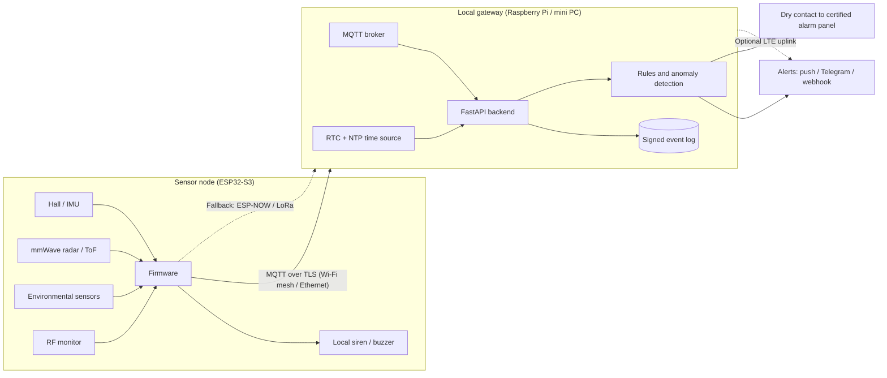

<div align="center">

# Wardline

**Open edge platform for object-level security and environmental monitoring of high-value assets.**

Local-first. Privacy-by-design. Built on ESP32-S3.

[](LICENSE)


</div>

> **Status: pre-alpha.** Wardline is a **complementary layer** designed to work alongside a certified alarm system. It is not a replacement for one and makes no certification claims today. APIs, hardware and layout will change.

## Table of contents

- [Why Wardline](#why-wardline)
- [Design principles](#design-principles)
- [Architecture](#architecture)
- [Hardware](#hardware)
- [Tiers](#tiers)
- [Repository layout](#repository-layout)
- [Getting started](#getting-started)
- [Roadmap](#roadmap)
- [Threat model](#threat-model)
- [Known limitations](#known-limitations)
- [Contributing](#contributing)
- [Security](#security)
- [License](#license)

## Why Wardline

Conventional alarm systems protect the **perimeter**: doors, windows, rooms. Once the perimeter is bypassed or the panel is disabled, the assets inside are exposed. Meanwhile, many valuable collections are damaged less by theft than by their environment: humidity, temperature swings, light and vibration.

Wardline moves protection **onto the asset itself**. Low-cost sensor nodes sit on or beside each protected object, and security and conservation data flow through a single, auditable pipeline.

Target environments: museums, churches and archives, jewelry stores, private collections, galleries, workshops, and any space with high-value, hard-to-replace items.

## Design principles

| Principle | What it means |
|---|---|
| **Object-level** | Tilt, movement, distance and presence are tracked per item, not just per room. |
| **Security + conservation** | Intrusion events and environmental data (temperature, humidity, light, vibration) share one system. |
| **Tamper-evident** | Events are timestamped, signed and hash-chained with pre/post-event buffers, so the log is usable as evidence. |
| **Self-protecting** | Secure boot, flash encryption, signed heartbeats and signed OTA updates; silence, tampering and RF interference raise alerts. |
| **Local-first** | No cloud and no internet required. Nodes talk over the site's local network (Wi-Fi mesh or wired), and keep working if that network degrades. |
| **Fail-safe** | A node that loses its network sounds a local siren, buffers events and resends them when connectivity returns. |
| **Privacy by design** | Radar and ToF only: no cameras, no facial recognition. |
| **Complementary** | A dry-contact output integrates with an existing certified alarm panel. |

## Architecture



**Network note.** Thick walls (churches, historic buildings) block Wi-Fi, so the reference deployment assumes a Wi-Fi mesh or wired Ethernet/PoE backbone covering all areas, plus a secondary radio fallback for critical nodes.

## Hardware

| Component | Role | Status |
|---|---|---|
| ESP32-S3 | Node MCU, secure boot, flash encryption | Core |
| Hall sensor | Open/close and object-seated detection | Core |
| MPU6050 | Tilt, vibration and movement | Core |
| HLK-LD2410C | mmWave presence detection | Core |
| VL53L1X | Time-of-flight distance | Core |
| Temperature / humidity / light sensors | Conservation monitoring | Core |
| DS3231 RTC | Reliable timestamps for the event log | Core |
| Buzzer / siren output | Local alarm if the network is down | Core |
| Relay / dry contact | Integration with an existing certified panel | Core |
| Raspberry Pi / mini PC | Local gateway: broker, backend, log | Core |
| CC1101 / nRF24 | RF noise-floor monitoring | Optional |
| SX1262 (LoRa) | Long-range fallback channel | Optional |
| LTE modem | Off-site alert uplink | Optional |
| Battery backup / PoE | Power-loss resilience and alerts | Recommended |

## Tiers

| Tier | Scope |
|---|---|
| **Base** | Per-object tamper and movement detection, local siren, MQTT alerts |
| **Plus** | Adds presence and distance sensing, environmental monitoring, dry-contact output |
| **Full** | Adds RF interference monitoring, signed audit log, fallback channel, power monitoring, statistical anomaly detection |

## Repository layout

```
firmware/    ESP32-S3 node firmware
backend/     FastAPI service: MQTT ingest, rules, event log, API
simulator/   Virtual nodes for developing and testing without hardware
dashboard/   Minimal web UI for status and alerts
docs/        Architecture, threat model, sensor notes, standards
tests/       Unit and integration tests
```

## Getting started

Wardline is pre-alpha: there is no runnable release yet. The first milestone (v0.1) will include the node simulator, so the backend and rules can be run without any hardware. Planned prerequisites:

- Python 3.11+
- An MQTT broker (e.g. Mosquitto)
- For real nodes: an ESP32-S3 dev board, the sensors above, and ESP-IDF or PlatformIO

Build and run instructions will land here with v0.1.

## Roadmap

- [ ] **v0.1**: Backend + node simulator: MQTT ingest, FastAPI, basic tamper events
- [ ] **v0.2**: Single real node: Hall + IMU, local siren, buffering and resend on reconnect
- [ ] **v0.3**: Radar/ToF presence, environmental monitoring, configurable alert rules
- [ ] **v0.4**: RTC/NTP timestamps, signed hash-chained event log with pre/post-event buffer
- [ ] **v0.5**: Secure boot, flash encryption, signed heartbeat, node provisioning and key management, signed OTA updates
- [ ] **v0.6**: Dry-contact output, power-loss detection, ESP-NOW/LoRa fallback channel
- [ ] **v0.7**: RF interference monitoring and statistical anomaly detection (thresholds first, ML later)
- [ ] **Later**: Certification path (EN 50131 / CEI 79-2 as reference) and GDPR review

## Threat model

**In scope:** object removal, node tampering, node removal or power loss, network loss, RF interference, event replay and forgery, log tampering, malicious firmware.

**Out of scope (for now):** perimeter intrusion detection (use a certified system), video surveillance.

A full threat model will live in `docs/threat-model.md`.

## Known limitations

- RF interference detection is best-effort: it relies on noise-floor changes and missing heartbeats, and cannot guarantee detection of every jamming technique.
- Anomaly detection starts as simple statistical thresholds; machine learning is a later goal.
- Not certified. Use as a complement to a certified alarm system.

## Contributing

Wardline is at an early stage and feedback is welcome. Please open an issue to discuss a change before sending a pull request. A `CONTRIBUTING.md` with coding standards and commit conventions will follow.

## Security

Please do not report vulnerabilities in public issues. A `SECURITY.md` with a private reporting channel will be added before the first release.

## License

Licensed under the [Apache License 2.0](LICENSE).
